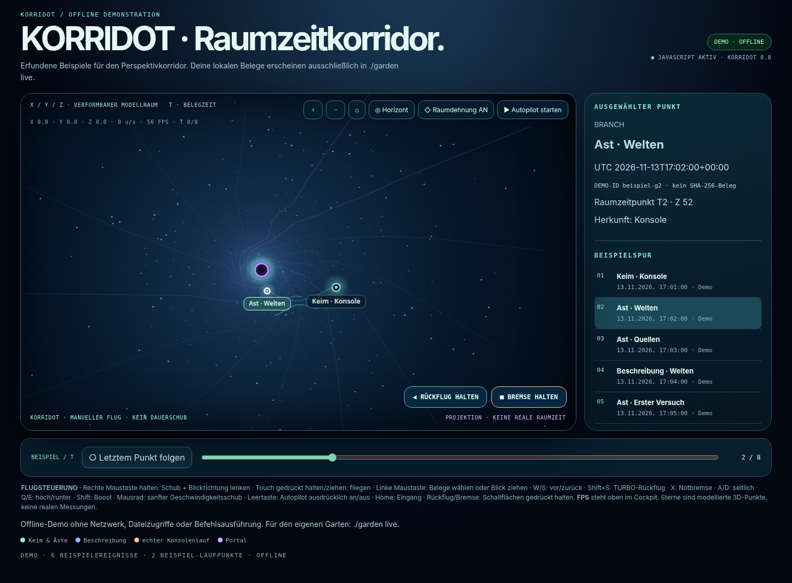

# Console Only · Console Zero


## Materialintegration · 17.11.2026

Die neue Standardansicht zeigt 960 bewegliche Materialzellen mit eigenen
Positionen, Geschwindigkeiten, Orientierungen und Winkelgeschwindigkeiten.
Nachbarkopplung erzeugt Kräfte und Drehmomente aus einem nematischen
Paarpotential. Die ursprünglichen expliziten Kern-/Medium- und Speicherregeln
bleiben erhalten. Die Kernmarkierungen sind zunächst ausgeschaltet.

Vier Hauptaktionen bleiben sichtbar: **Pause/Weiter, Neu starten, Aufnehmen,
Mehr**. Die Werkstatt enthält die alten Modelle, Feld-/Zell-/Orientierungs-
und Flugansicht, Blau/Gold oder drei RGB-Anzeigeklassen, Symbolgröße,
Kamerazoom, JSON-Wiederherstellung und 4K-PNG. Zoom, Farbe und Symbolgröße
verändern keine Masse oder Kräfte. Die RGB-Klassen bezeichnen keine realen
Protonen, Elektronen oder Neutronen. Das Modell ist dimensionslos; es ist
nicht auf atomare Abstände, Temperatur oder spontane Masseerzeugung kalibriert.

`src/material-engine.js`, `src/material-model.js` und `src/material-view.js`
werden bytegleich auch in der Forschungswebsite verwendet. JSON enthält
stabile Material-IDs, tatsächliche θ/ω-Werte, vollständigen Rechenzustand,
Eingaben, Zeitguthaben und Quellenbindungen. Die gespeicherten exakten
IEEE-754-Werte erhalten auch negatives Null. Ein Rechenfehler erhält den
letzten gültigen Zustand und löst keine automatische Wiederholung aus.

Die vorhandene Bedienung bleibt der Einstieg:

```bash
python -B tools/build_preview.py
./garden live
```

Die statische `docs/`-Vorschau enthält ausschließlich synthetische Beispiele.
Eine Veröffentlichung dieses Branches ist von einer Aktualisierung der
GitHub-Pages-Livefassung getrennt. Die Pfadlizenz bleibt [MIT](LICENSE);
externe Projekte behalten ihre jeweiligen Rechte.

Reproduzierbare vorhandene Prüfungen:

```bash
node --experimental-vm-modules --test tests/*.test.mjs
node --test tests/material-kernel.test.cjs
python -B -m unittest discover -s tests -p 'test_*.py'
```

Die aktuelle begrenzte Abnahme steht in `docs/MATERIAL_ACCEPTANCE.json`.
Ergebnisse früherer Abschnitte sind historische Prüfstände.

## HALVETH / KORRIDOT 0.8 · begehbare Ereignisse

**[3D-Demo im Browser öffnen](https://juri-halveth.github.io/console-only/)** · [Programmcode](https://github.com/Juri-Halveth/console-only) · [Projektübersicht](https://juri-halveth.github.io/arbeiten/)



KORRIDOT macht **aufgezeichnete Software-Versuche räumlich erkundbar**. Ein 3D-Modellkorridor zeigt Ereignismarkierungen, Zeitpunkte und verknüpfte Belege. Die öffentliche Demo enthält **nur synthetische Daten**. Sie liest keine lokalen Dateien und startet keine Programme.

**Fliegen:** Rechte Maustaste halten und lenken oder Touch gedrückt ziehen. `W` vorwärts, `S` zurück, `Shift+S` Turbo-Rückflug, `X` bremsen, `Home` zum Eingang; `Leertaste` schaltet den Autopiloten bewusst um. Ein Klick auf Ereignismarkierungen oder auf die Zeitspur zeigt die Details. Sterne sind modellierte 3D-Punkte, keine astronomischen Daten. Für deine eigenen lokalen Belege verwende `./garden live`.

**Architektur:** HALVETH = Projektfamilie; KORRIDOT = räumliche Bedienoberfläche; Console Only / Console Zero = lokaler Baukasten; Garden = ausdrücklich erfasste Knoten und Ausführungsbelege. Keine physikalische Zeitreise, kein autonomer Fremdprozess-Scan und keine Sandbox. Die `.zero/`- und `inbox/`-Daten bleiben lokal und sind von Git ausgeschlossen.

**Aktuelle Prüfung reproduzieren:** `python -B -m unittest discover -s tests -q`, `python -B tools/build_preview.py` und `node --check src/garden_live.js` (Node optional). Die weiter unten erwähnten 33 Tests sind ein **historisches Ergebnis vom 13.11.2026** und kein aktueller Teststand.

---

**Ein lokaler Baukasten, der mit einer Konsole anfängt.** Du setzt einen Keim,
verzweigst ihn mit Befehlen und siehst seine Ereignisse in einer navigierbaren
Zeitansicht. Quellen und Modellgespräche sind eigene, ausdrücklich gestartete
Wege. Das Projekt ist ein Prototyp, kein autonomes KI-System.


**[Interaktive HTML-Vorschau öffnen](https://juri-halveth.github.io/console-only/)** ·
Beispieldaten ohne Server, Anmeldung oder lokale Dateien. Die echte Ansicht
deiner eigenen Belege startet mit `./garden live`. Die Vorschau wird aus
`src/garden_live.html` und `src/garden_live.js` mit
`python -B tools/build_preview.py` erzeugt.

## In drei Minuten ausprobieren

Voraussetzung: Python 3 mit `python` im Pfad und Bash (unter Windows z. B.
Git Bash). Es werden keine Pakete installiert. Klone das Repository in einen
neuen Ordner und führe dort aus:

```bash
./zero init
./garden init
./garden seed 'Konsole'
./garden branch 'Konsole' 'Welten'
./garden branch 'Konsole' 'Quellen'
./garden live
```

`./garden live` startet einen lesenden Server auf `127.0.0.1` und druckt
eine URL. Falls der Browser nicht automatisch öffnet, kopiere diese URL in
die Adresszeile. Lass das Terminal laufen. In einem zweiten Terminal:

```bash
cd /pfad/zu/console-only
./garden branch 'Welten' 'Erster Versuch'
./garden describe 'Welten' 'Ein eigener Raum entsteht.'
./garden run 'Welten' -- python -B -c 'print("Hallo aus einem echten Lauf")'
```

Der Browser liest alle zwei Sekunden den lokalen Beleg neu. Klicke auf
Knoten und Ereignispunkte, ziehe den Raum, zoome und bewege den Zeitregler.
`./garden live` endet mit Strg+C. `./garden verify` prüft die gespeicherten
Gartenereignisse; `./garden status` zeigt den Baum. Eine statische Ansicht
ohne laufenden Server gibt es mit `./garden open`.

## Was wirklich geschieht

| Einstieg | Gegenwärtige Wirkung |
| --- | --- |
| `./zero` | Speichert ausdrücklich hinzugefügte UTF-8-Dateien als lokale Quellen mit SHA-256-Belegen; `find` sucht darin. `ask` fragt optional ein schon installiertes Ollama-Modell. |
| `./live` | Lokale Textsitzung mit Ollama, ID, UTC-Zeit und gespeichertem Gespräch. Normale Sätze gehen an das Modell. Nur `! BEFEHL` startet ausdrücklich Bash mit Benutzerrechten. |
| `./garden` | Ein Keim, Äste, Beschreibungen und ein optionaler Link ins öffentliche HALVETH NETZ. `run` startet ein ausdrücklich benanntes Programm und hält Start, Ausgang, Exit-Code und begrenzte Ausgabe fest. |
| `./garden live` | Lokale Raum- und Zeitansicht der **aufgezeichneten** Gartenereignisse und `garden run`-Läufe. Ein Zeitregler spielt die gespeicherte Reihenfolge ab. |

Die Darstellung von Zweig, Tiefe und Zeit ist eine Bedienoberfläche, keine
physikalische 4D-Simulation. Nur Befehle, die durch Console Zero laufen,
erscheinen als solche in seinem Log. Andere Shells, fremde Prozesse, GitHub
und externe Websites werden nicht automatisch beobachtet. Das Portal zu
[HALVETH NETZ](https://juri-halveth.github.io/universum/) öffnet erst nach
einem ausdrücklichen Klick; es importiert dessen Code nicht.

`ask` und die Antworten in `./live` sind ungeprüfte Modellvorschläge.
Gespeicherte Quellen sind keine Garantie, dass eine Modellantwort richtig
ist. Weder `./zero` noch `./garden` laden Modelle selbst herunter.

## Lokale Daten und Grenzen

`.zero/` und `inbox/` bleiben außerhalb von Git. Dort liegen Quellen,
Sitzungstexte, Befehlsargumente und begrenzte Programmausgaben **im
Klartext**. Gib in `garden run` und `./live` keine Geheimnisse ein, die
im lokalen Beleg erscheinen sollen. `! BEFEHL` in `./live` ist keine
Sandbox. `garden run` verwendet keine implizite Shell, aber das von dir
gewählte Programm hat deine normalen Benutzerrechte. Der lokale
Browserdienst ist lesend und nur an Loopback gebunden. Eine Hash-Kette
erkennt gewöhnliche Beschädigungen; sie widersteht keinem Prozess mit
denselben Schreibrechten. Parallele Schreiber sind nicht unterstützt.

Der Garten umfasst höchstens 48 Knoten und 256 Ereignisse; der separate
Ausführungsbeleg höchstens 128 Start-/Ende-Ereignisse. Ein nach START
abgebrochener Prozess bleibt als offener Versuch sichtbar und wird nicht
automatisch wiederholt. Mehr Einzelheiten: [GARDEN.md](GARDEN.md).

## Prüfen

```bash
python -B -m unittest discover -s tests -v
node --check src/garden_live.js  # falls Node vorhanden ist
```

Am 13. November 2026 bestanden 33 lokale Python-Tests. Ein Konsolenlauf
und ein Browsermitschnitt auf Windows zeigten den neuen Ast und die
Laufpunkte. Das ist eine begrenzte Prototypabnahme, kein Produktionstest
und keine GitHub-CI-Aussage.

## Nächste Wachstumsstufen

1. Öffentliche Quellrevisionen **lesend und mit Commitbindung** als eigene
   Ereignisart erfassen. Modellzeit und Commitzeit bleiben getrennt.
2. Wiederholbare Aufträge aus mehreren lokalen Werkzeugen zusammenstellen;
   jeder Schritt hält Eingabe, Wirkung, Ergebnis und offene Fehler fest.
3. Visuelle Räume aus vorhandenen, lizenzgeprüften HALVETH-Bausteinen
   ausdrücklich übernehmen und ihre Herkunft pro Raum anzeigen.
4. Erst danach Beiträge anderer Personen als getrennte, nachvollziehbare
   Zweige mit klaren Zuständigkeiten ermöglichen.

Die Idee von „Beschwörung“ meint hier eine präzise, nachvollziehbare
Aufgabe an lokale Werkzeuge: **Wunsch → gewählter Befehl → beobachtete
Wirkung → Beleg → menschliche Prüfung**. Weniger Handarbeit ist das Ziel;
mehr Fähigkeiten werden erst behauptet, wenn sie tatsächlich angeschlossen
und geprüft sind.

## Lizenz

Der Code dieses Repositories steht unter [MIT](LICENSE). Externe Projekte,
auf die Dokumentation oder Portale verweisen, behalten ihre eigenen Rechte.

## Doppelacht im Flugraum

In der Vorschau dieses Branches öffnet die Abfrage `?modell=doppelacht` direkt die 3D-Szene. Unter **Mehr** stehen vier Kameras, Zellverfolgung, Kopplung, JSON und 4K bereit. [Modell und Prüftoleranzen](DOPPELACHT.md).
